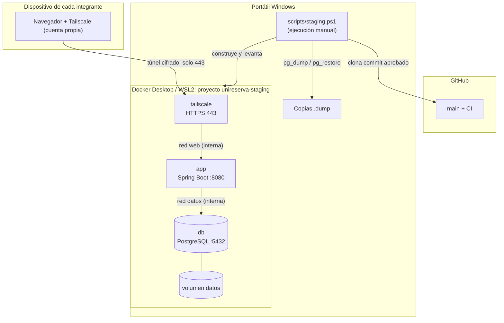

# Diagrama de despliegue: staging local (propuesto)

Fuera del diagrama porque no participan: no hay puertos publicados en el equipo ni en el router. Solo el contenedor `tailscale` tiene salida a Internet (red `salida`).

Este diagrama describe staging, no el diagrama de despliegue final que exige el curso.
